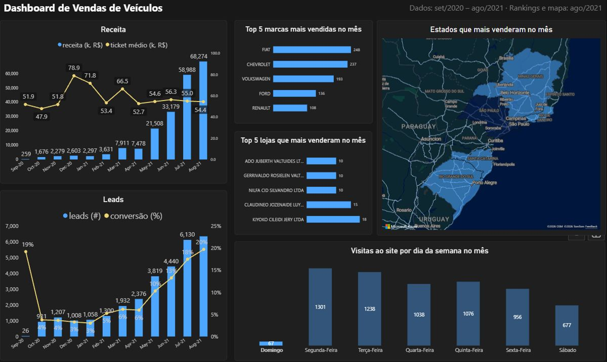

# Dashboard de Vendas de Veículos · SQL + Power BI

Análise de vendas de uma loja online de veículos, do banco de dados ao dashboard: consultas em **PostgreSQL**, cinco **views** de indicadores e um painel interativo no **Power BI**, publicado na web.

**[▶ Abrir o dashboard ao vivo](https://app.powerbi.com/view?r=eyJrIjoiMzE4MTU4NWQtZjk0YS00Nzk1LWI0NzktODFmNzJkNTc5ZDIxIiwidCI6ImFmZjY0MmI3LTg1MTEtNGFhMi04ZGIyLThkMDE3MTI0Yjc5NyJ9)** · **[Portfólio](https://deivithmb.github.io)**

---

## Contexto
Loja online de veículos com dados de **visitas ao site, clientes, produtos e lojas**, de **setembro de 2020 a agosto de 2021**. O objetivo foi montar um painel mensal para acompanhar o desempenho comercial.

## Perguntas de negócio
1. Como evoluíram **receita, leads, conversão e ticket médio** mês a mês?
2. Quais **estados** mais venderam?
3. Quais **marcas** mais venderam no mês?
4. Quais **lojas** mais venderam no mês?
5. Em quais **dias da semana** o site recebe mais visitas?

## Ferramentas
| Etapa | Ferramenta |
|---|---|
| Banco de dados | PostgreSQL 18 + pgAdmin 4 |
| Consultas | SQL (JOINs, agregações, `date_trunc`, `CASE WHEN`, views) |
| Visualização | Power BI Desktop + Power BI Service (Publicar na Web) |

## Processo
1. **Exploração** das tabelas `funnel`, `customers`, `products` e `stores` (schema `sales`).
2. **Consultas SQL** para cada pergunta, com conferência dos totais (testes de sanidade).
3. **Cinco views** com os indicadores prontos para o Power BI:

| View | O que entrega |
|---|---|
| `vw_monthly_kpis` | leads, vendas, receita, conversão e ticket médio por mês |
| `vw_sales_by_state` | vendas por estado e mês |
| `vw_sales_by_brand` | vendas por marca e mês |
| `vw_sales_by_store` | vendas por loja e mês |
| `vw_visits_by_weekday` | visitas por dia da semana e mês |

4. **Conexão do Power BI ao PostgreSQL** (modo Import) e construção do dashboard: gráfico combinado com eixo secundário, rankings com filtro Top N, mapa (Azure Maps) e ordenação personalizada dos dias da semana.
5. **Publicação na web** para acesso público e interativo.

## Principais insights
- **Receita cresceu 263×** em 12 meses: de R$ 259 mil (set/20) para **R$ 68,3 milhões** (ago/21).
- O **ticket médio ficou estável**, perto de R$ 54 mil: o crescimento veio do **volume de vendas**, não do preço.
- A **conversão de leads** caiu até 3% no início de 2021 e subiu para **20%** em agosto.
- **São Paulo** concentra as vendas: **734** em ago/21, cinco vezes mais que Minas Gerais (142).
- O site recebe mais visitas **de segunda a quarta**, e bem menos no fim de semana.

## Arquivos
| Arquivo | Conteúdo |
|---|---|
| `projeto1_queries.sql` | consultas e criação das views |
| `projeto1_dashboard.pbix` | arquivo do Power BI (abre no Power BI Desktop, gratuito) |
| `images/` | prints do dashboard |

## Versão 2
A **[versão 2](https://github.com/DeivithMB/vehicle-sales-star-schema)** remodela o projeto em **esquema estrela** (tabela fato + dimensões e medidas DAX): um clique em qualquer visual filtra todo o painel, e um único filtro de mês responde todas as perguntas.

---
Projeto desenvolvido a partir do curso *SQL para Análise de Dados* (Midori Toyota). Os dados são fictícios.
**Deivith Rodrigues** · [LinkedIn](https://www.linkedin.com/in/deivith-rodrigues-655aa1142) · [Portfólio](https://deivithmb.github.io)
